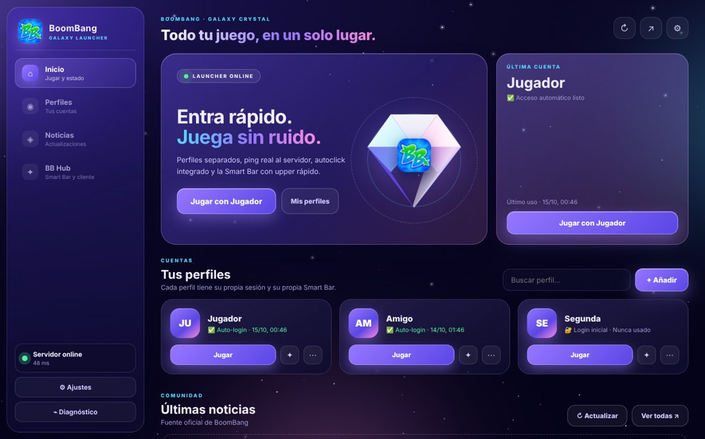
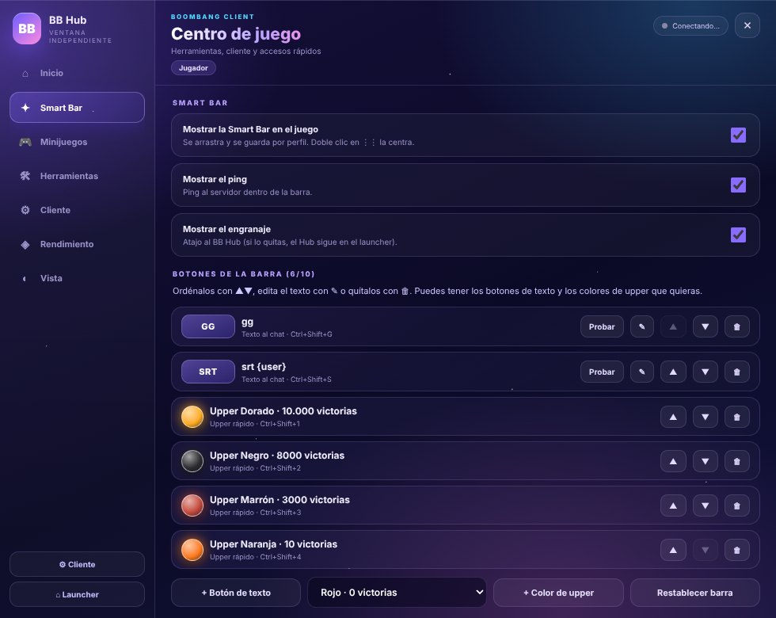
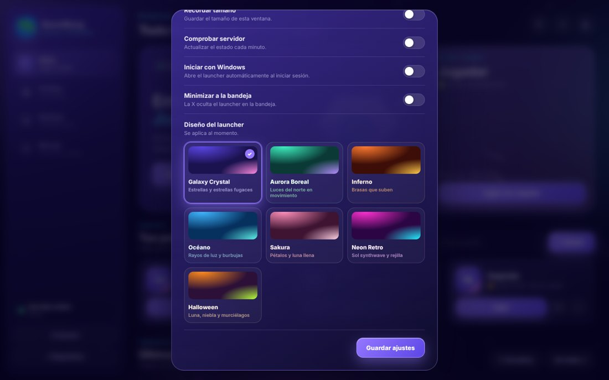

# BoomBang Launcher

Launcher de escritorio **no oficial** para jugar a [BoomBang](https://www.boombang.tv/es/) (versión HTML5) con varias cuentas, una barra de atajos dentro del juego y un diseño animado a elegir.

> Proyecto de fans. No está afiliado ni respaldado por BoomBang.



## Qué incluye

- **Perfiles separados**: cada cuenta tiene su propia sesión. Inicias sesión una vez y el launcher entra solo las siguientes veces (la contraseña se guarda cifrada con el sistema de Windows).
- **Smart Bar dentro del juego**: una barra flotante con los botones que tú elijas.
  - Botones de texto para el chat, con `{user}` para el jugador cuya ficha tengas abierta (por ejemplo `srt {user}`).
  - **Upper rápido**: botones para cualquiera de los 17 colores de guante. Pulsan el «+» del upper y eligen el color por ti.
  - Ping real al servidor del juego.
  - Atajos de teclado configurables para cada botón.
- **BB Hub**: panel para configurar la Smart Bar, calibrar el upper, copiar la configuración a tus otros perfiles y ajustar la vista del cliente.
- **Autoclick integrado** (desactivado por defecto): F3 guarda la posición del ratón, F1 empieza y F2 para (teclas y velocidad configurables en el BB Hub). Dentro de BoomBang los clics van directos al juego y **tu ratón queda libre**.
- **Aviso de objetos**: un sonido suave cuando cae un objeto que le hayas enseñado (BB Hub → Avisos). Solo avisa; recogerlo lo haces tú.
- **7 diseños animados** para el launcher: Galaxy Crystal, Aurora Boreal, Inferno, Océano, Sakura, Neon Retro y Halloween.



## Descarga

**[⬇ Descargar BoomBang Launcher para Windows](https://github.com/boombangstaffhub/BoombangLauncher/releases/latest/download/BoomBang-Launcher-Setup.exe)**

Abre `BoomBang-Launcher-Setup.exe`, sigue el instalador y listo: crea un acceso directo en el escritorio y en el menú Inicio. No hace falta instalar nada más.

- Funciona en Windows 10 y 11 (64 bits).
- Como el instalador no está firmado, Windows puede mostrar «Windows protegió tu PC» la primera vez: pulsa **Más información → Ejecutar de todas formas**.

<details>
<summary>Ejecutar desde el código (para desarrolladores)</summary>

Necesitas [Node.js](https://nodejs.org/) (LTS).

```bash
git clone https://github.com/boombangstaffhub/BoombangLauncher.git
cd BoombangLauncher
npm install
npm start
```

O descarga el código como ZIP y haz doble clic en `Iniciar.bat`. Para generar el instalador en tu PC: `npm run dist` (queda en `dist/`).
</details>

## Primeros pasos

1. **Añade una cuenta** con «+ Añadir» y pulsa **Jugar**. Inicia sesión en BoomBang una vez; las siguientes veces entrará solo.
2. Dentro del juego aparece la **Smart Bar**. El engranaje ⚙ abre el **BB Hub**.
3. En el Hub, pestaña **Smart Bar**, configura tus botones y atajos.
4. Para el **upper rápido**, abre la ficha de un jugador y pulsa «Calibrar todo»: te irá diciendo qué pulsar (el «+» y luego cada color). Durante la calibración los clics de color no se envían al juego. Se hace una sola vez.
5. Si tienes varias cuentas, usa **«Copiar a otros perfiles»** para no repetir la configuración.

### Atajos por defecto

| Acción | Tecla |
|---|---|
| Primer botón de texto (GG) | Ctrl + Shift + G |
| Segundo botón de texto (SRT) | Ctrl + Shift + S |
| Colores de upper | Ctrl + Shift + 1 … 4 |
| Mostrar / ocultar la Smart Bar | Ctrl + Shift + B |

Todos se pueden cambiar en el Hub. Las teclas del autoclick (F1, F2 y F3 por defecto) quedan reservadas para él.

### Autoclick

Actívalo en **Ajustes → Autoclick** del launcher o en el **BB Hub → Autoclick**. Por defecto:

- **F3**: guarda la posición actual del ratón.
- **F1**: empieza a hacer clics en el punto guardado.
- **F2**: para.

En el **BB Hub → Autoclick** puedes cambiar:

- **Las teclas** de las tres acciones. Valen F1–F12, letras, números, Insert, Inicio, Re Pág, etc., y también la rueda o los botones laterales del ratón.
- **La velocidad** (intervalo entre tandas de clics, de 1 a 1000 ms). **1 ms es el modo máximo** (8 clics por tanda); a partir de 2 ms hace 6 clics por tanda como el original. Si el PC se traba, súbelo a 30–100 ms.

La configuración del autoclick es la misma para todos tus perfiles. Usa Windows PowerShell, que viene con Windows. Algunos antivirus pueden avisar la primera vez porque es un programa que hace clics; el código está en [`autoclick.cs`](autoclick.cs).



## Tus datos

Nada de lo que configuras se guarda en esta carpeta. Perfiles, contraseñas (cifradas), atajos, calibraciones y ajustes viven en:

```
%APPDATA%\BoomBangLauncher
```

Por eso las actualizaciones nunca borran tu configuración. El botón **Diagnóstico → Abrir carpeta de datos** te lleva a esa carpeta.

## Actualizaciones

El launcher se actualiza solo:

- Al abrirlo comprueba si hay una versión nueva y, si la hay, muestra un aviso con las **novedades** y el botón **Actualizar**.
- Al pulsarlo descarga la versión nueva, la instala y se reinicia. Tus perfiles y ajustes no se tocan.
- Cierra las ventanas de BoomBang antes de actualizar.
- También puedes buscar a mano en **Ajustes → Versión → Buscar ahora**, o desactivar el aviso en **Ajustes → Buscar actualizaciones al abrir**.

### Publicar una versión nueva (mantenedores)

1. Sube el número de `version` en `package.json` (por ejemplo `1.0.0` → `1.1.0`).
2. Añade arriba en `CHANGELOG.md` una sección `## 1.1.0` con los cambios: es lo que verá la gente en «Novedades».
3. Haz push a `main`. GitHub Actions crea el instalador y publica la versión en **Releases**; todos los launchers verán el aviso la próxima vez que se abran.

## Estructura

| Archivo | Para qué sirve |
|---|---|
| `main.js` | Proceso principal: ventanas, perfiles, ajustes, autoclick |
| `index.html`, `renderer.js`, `style.css`, `galaxy.js` | Ventana del launcher y sus diseños animados |
| `game-preload.js` | Se ejecuta dentro del juego: auto-login, vista del cliente, ping |
| `smartbar.js` | La Smart Bar (botones, upper rápido, atajos) |
| `drops.js`, `pixi-hook.js`, `visual.js` | Aviso de objetos (por su nombre en el juego; por forma como respaldo) |
| `client-hub.js`, `client-hub.css`, `hub-window.html` | El BB Hub |
| `rtt.js` | Medición del ping |
| `autoclick.cs`, `autoclick.ps1` | El autoclick |
| `updater.js`, `update.json` | Actualizaciones desde GitHub |
| `.github/workflows/release.yml` | Crea el instalador y la Release en cada versión nueva |
